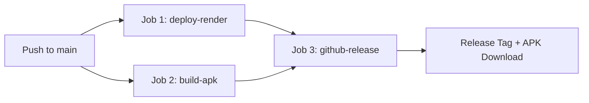

# 🎒 לוֹמֵד (Lomed) - החבר הדיגיטלי לבית הספר
### AI-Powered Hebrew School Companion • Handwritten Notes OCR, Summaries & Homework Tracker

**לוֹמֵד** היא מערכת מלאה (Full-Stack Web & Android App) המיועדת לתלמידי בתי ספר בישראל. התלמיד מצלם או מעלה דפי מחברת בכתב יד בעברית (רציף, עגול או דפוס), והמערכת:
1. **מפענחת את כתב היד** באמצעות מודל `gemini-2.5-flash` וה-SDK הרשמי `@google/genai`.
2. **מייצרת סיכומי שיעור תמציתיים ומובנים** עם חלוקה למושגי מפתח ונושאים.
3. **מחלצת באופן אוטומטי שיעורי בית ומטלות** עם תאריכי יעד ורמות דחיפות.
4. **מציגה לוח מחוונים עברי אינטראקטיבי (RTL)** עם סימוני ביצוע (צ'קבוקסים), סינונים לפי מקצוע ושיתוף לוואטסאפ.
5. **ארוזה כאפליקציית אנדרואיד Native (APK)** באמצעות CapacitorJS.
6. **צינור CI/CD אוטומטי ב-GitHub Actions** לפריסה ב-Render והפצת קובצי APK ב-GitHub Releases.

---

## 🏗 ארכיטקטורה וטכנולוגיות

| רכיב | טכנולוגיה | תיאור |
| :--- | :--- | :--- |
| **Backend** | Node.js & Express | שרת API מהיר, ניהול העלאות תמונות בזיכרון (Multer) וממשק עם Gemini. מוגדר לפריסה ב-Render. |
| **AI Engine** | `@google/genai` (Gemini 2.5 Flash) | פענוח מולטי-מודאלי של כתב יד עברי ופליטת JSON מובנה ומאומת. |
| **Frontend** | HTML5, Tailwind CSS, JavaScript | ממשק עברי מודרני מיושר לימין (`dir="rtl"`), רספונסיבי למובייל ומחשב, ללא ספריות כבדות. |
| **Mobile** | CapacitorJS (`@capacitor/android`) | מעטפת נייטיב לאנדרואיד האורזת את תיקיית `public/` לאפליקציית Android עצמאית. |
| **CI/CD** | GitHub Actions | צינור רב-שלבי: הפעלת פריסה ב-Render, בניית APK עם Gradle ושחרור גרסה ב-GitHub Releases. |

---

## ⚙️ הגדרת Secrets ב-GitHub

כדי שצינור ה-CI/CD ב-GitHub Actions יוכל לפרוס אוטומטית ל-Render ולשחרר גרסאות APK:

1. היכנס למאגר ה-GitHub של הפרויקט.
2. לחץ על **Settings** > **Secrets and variables** > **Actions**.
3. לחץ על **New repository secret** והוסף את הסודות הבאים:

| שם הסוד (Name) | תיאור וערך |
| :--- | :--- |
| `RENDER_DEPLOY_HOOK` | כתובת ה-Deploy Hook מלוח הבקרה של Render (ראו סעיף פריסה ב-Render להלן). |
| `GEMINI_API_KEY` | מפתח ה-API האישי שלכם מ-[Google AI Studio](https://aistudio.google.com/). |

> **הערה לגבי הרשאות GitHub Actions:**  
> תחת **Settings** > **Actions** > **General** > **Workflow permissions**, וודאו שמסומן **Read and write permissions** כדי שפעולת `github-release` תוכל ליצור Releases ולצרף את קובץ ה-APK.

---

## 🚀 פריסת ה-Backend לשירות Render

1. היכנסו ל-[Render.com](https://render.com/) ופתחו חשבון / התחברו.
2. לחצו על **New +** ובחרו ב-**Web Service**.
3. חברו את מאגר ה-GitHub של הפרויקט.
4. הגדירו את פרטי השירות:
   - **Name:** `lomed-school-companion` (או כל שם שתבחרו)
   - **Environment:** `Node`
   - **Build Command:** `npm install`
   - **Start Command:** `node server.js`
   - **Plan:** Free
5. תחת **Environment Variables**, הוסיפו:
   - `GEMINI_API_KEY`: המפתח שלכם מ-Google AI Studio.
   - `NODE_ENV`: `production`
   - `PORT`: `10000` (או ברירת המחדל של Render).
6. לחצו על **Create Web Service**.
7. **השגת Deploy Hook:**  
   בדף השירות ב-Render, גללו אל **Deploy Hook**, העתיקו את ה-URL הייחודי, והזינו אותו כ-Secret ב-GitHub בשם `RENDER_DEPLOY_HOOK`.

---

## 📱 אריזת אפליקציית Android עם Capacitor

הפרויקט מוגדר עם Capacitor ב-`capacitor.config.json` כאשר נכסי הווב מוזנים מתיקיית `public/`.

### דרישות מקדימות לפיתוח מקומי באנדרואיד
- [Node.js 22+ (LTS)](https://nodejs.org/)
- [Java JDK 21](https://adoptium.net/)
- [Android Studio](https://developer.android.com/studio) מותקן עם Android SDK Command-line Tools.

### פקודות סנכרון ובנייה
```bash
# 1. התקנת תלויות
npm install

# 2. הוספת פלטפורמת אנדרואיד (בפעם הראשונה בלבד)
npm run cap:add

# 3. סנכרון קובצי הווב (public/) אל תוך פרויקט האנדרואיד
npm run cap:sync

# 4. פתיחת הפרויקט ב-Android Studio להרצה על מכשיר או אמולטור
npm run cap:build
```

### בניית קובץ APK ישירות משורת הפקודה
```bash
cd android
./gradlew assembleDebug
# קובץ ה-APK ייווצר בנתיב:
# android/app/build/outputs/apk/debug/app-debug.apk
```

> **חיבור האפליקציה במובייל לשרת Render:**  
> באפליקציית האנדרואיד, לחצו על סמל גלגל השיניים ⚙️ בראש המסך והזינו את כתובת השרת שלכם ב-Render (למשל: `https://lomed-school-companion.onrender.com`). ההגדרה תישמר במכשיר.

---

## 🔄 צינור CI/CD ב-GitHub Actions

קובץ ה-Workflow נמצא בנתיב `.github/workflows/deploy-and-release.yml` ומורכב מ-3 שלבים מופרדים:



1. **`deploy-render`:** שולח בקשת HTTP POST אל ה-Deploy Hook של Render ומפעיל פריסה מיידית של גרסת השרת העדכנית.
2. **`build-apk`:**
   - מקים סביבת Ubuntu עם Node.js 20, Java 17 ו-Android SDK.
   - מריץ `npx cap sync android` לעדכון הנכסים.
   - מריץ `./gradlew assembleDebug` ומייצר קובץ `Lomed-SchoolCompanion-debug.apk`.
   - שומר את ה-APK כ-Artifact זמני של ה-Workflow.
3. **`github-release`:**
   - ממתין לסיום מוצלח של בניית ה-APK.
   - מייצר גרסה חדשה (למשל `v1.0.42`) ב-GitHub Releases.
   - מצרף את קובץ ה-`Lomed-SchoolCompanion-debug.apk` להורדה ישירה עבור התלמידים.

---

## 💻 הרצה ופיתוח מקומי (Local Development)

1. שכפלו את המאגר:
   ```bash
   git clone <REPO_URL>
   cd <REPO_NAME>
   ```

2. הגדירו את קובץ הסביבה `.env`:
   ```env
   GEMINI_API_KEY="AIzaSy..."
   PORT=3000
   ```

3. הפעילו את שרת הפיתוח:
   ```bash
   npm run dev
   ```

4. פתחו את הדפדפן בכתובת:
   ```
   http://localhost:3000
   ```

---

## ✨ פיצ'רים עיקריים לתלמיד

- **סורק מולטי-עמודים:** העלאה של עד 10 תמונות מחברת בו-זמנית עם תצוגה מקדימה ומחיקה נוחה.
- **מנוע OCR עברי ממוקד:** קריאה מדויקת של כתב יד עברי, כולל ראשי תיבות נפוצים (ש״ב, תנ״ך, עמ׳).
- **מעקב שיעורי בית:** חלוקה למשימות עם צ'קבוקסים, תאריכי יעד ורמות דחיפות.
- **הוספת מטלה ידנית:** אפשרות להוסיף במהירות משימה שהמורה נתן בעל פה.
- **סיכום ומושגי מפתח:** ריכוז תמציתי של החומר הנלמד בתוספת כרטיסיות מונחים להכנה למבחנים.
- **שיתוף לוואטסאפ (WhatsApp):** שיתוף בלחיצת כפתור של סיכום השיעור ושיעורי הבית עם חברים לכיתה.
- **מצב דוגמה מובנה (Demo):** כפתור "טען דוגמת מחברת" המאפשר לבחון את המערכת מיד ללא צורך בצילום מקדים.

---

## 📄 רישיון
פרויקט זה מופץ תחת רישיון Apache 2.0. לפרטים נוספים ראו קובץ LICENSE.
